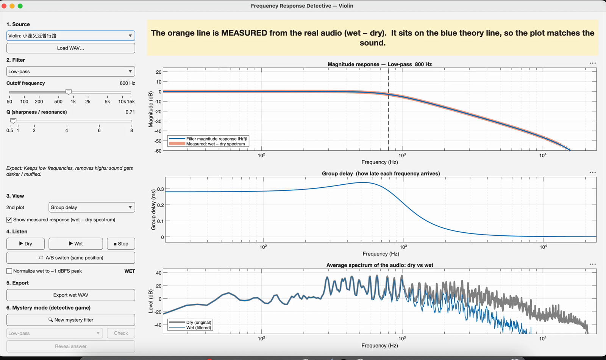
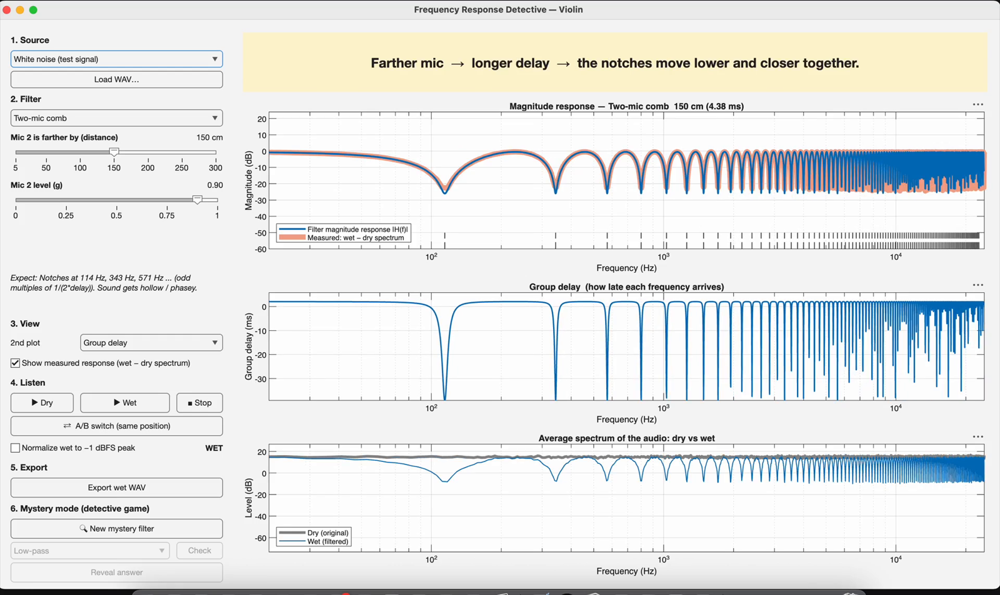
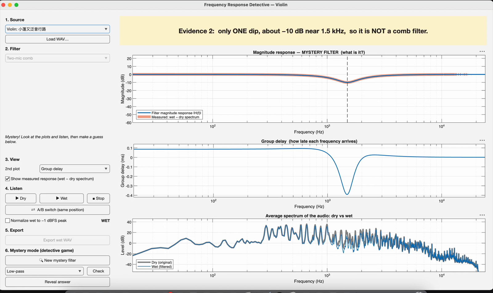

# Frequency Response Detective — Violin

A MATLAB tool to **see and hear** what a filter does.
Choose a filter, move the sliders, and the plots change at the same time.
Then play the dry sound and the wet (filtered) sound and compare.

*MUE 602 Digital Audio Theory — AI Build Lab, University of Miami, Fall 2026 — Jinglan Huang*



▶️ **Demo video (3 min 30 s):** [docs/FrequencyResponseDetective_demo_JinglanHuang.mp4](docs/FrequencyResponseDetective_demo_JinglanHuang.mp4)

## Features

- **Four filters:** low-pass, high-pass, peaking EQ (a deep cut works like a notch), and a two-microphone comb filter
- **Three plots:** magnitude response (dB), unwrapped phase **or** group delay, and the average spectrum of the dry and wet audio
- **Measured response:** the orange line is *wet spectrum − dry spectrum*, computed from the real audio. It sits on the blue theory line, so you can check that the plot matches the sound
- **Listening:** Play Dry / Play Wet, and an **A/B switch** that jumps between dry and wet at the same time position
- **Mystery mode:** the program picks a random filter and hides its name. Look, listen, guess, then reveal the answer
- **Export:** save the wet sound as a 24-bit WAV file
- **Base MATLAB only:** no toolboxes needed (I wrote my own function instead of `freqz`)

## How to run

1. Open MATLAB and set the **Current Folder** to this folder.
2. In the Command Window, type:

```matlab
FrequencyResponseDetective   % open the GUI
verify_project               % 11 automatic tests (should print 11 PASS)
run_experiments              % export all WAV files and figures to exports/
demo_tour                    % automatic 3.5-minute demo with captions
```

## The filters

| Filter | Settings in the WAV files | What the plot shows | What I hear on the violin |
|---|---|---|---|
| Low-pass | 1000 Hz, Q 0.71 | −3 dB at 1 kHz, then goes down | Darker, muffled |
| High-pass | 1000 Hz, Q 0.71 | Low frequencies go down | Thin, no body |
| Peaking EQ | 3000 Hz, Q 1.4, +12 dB | A "hill" at 3 kHz | Brighter, sharper |
| Peaking EQ (deep cut) | 660 Hz, Q 4, −24 dB | A narrow "hole" at 660 Hz | Notes near E5 get weaker |
| Two-mic comb | mic 2 is 10 / 34 / 100 cm farther | Many equal notches | Hollow, "phasey" |

The low-pass, high-pass and peaking EQ are second-order biquad filters (RBJ Audio EQ Cookbook).

### Two microphones → comb filter

Mic 2 is farther from the violin, so its sound arrives later. When the two mics are mixed, some frequencies cancel.

- 34.3 cm ÷ 343 m/s = **1 ms** delay
- A wave cancels when it is half a period late → period = 2 ms → **500 Hz**
- More notches at 1500 Hz, 2500 Hz, …

A farther mic gives a longer delay, so the notches move lower and closer together.



### Mystery mode



Evidence: low and high frequencies stay at 0 dB (not a low-pass or high-pass), and there is only one dip, near 1.5 kHz (not a comb filter). My guess was **peaking EQ (cut)**, and it was correct: 1500 Hz, −10 dB.

## Verification

`verify_project` runs 11 tests. Some examples:

- Low-pass and high-pass at 1 kHz: −3.01 dB at the cutoff
- Peaking EQ: exactly +12.00 dB at the center frequency
- Comb filter (34.3 cm): 48-sample delay, notches at 500 / 1500 / 2500 Hz
- My frequency response function matches the FFT of the impulse response (error < 1e-8 dB)
- All biquad poles are inside the unit circle (stable)
- Measured response (white noise, wet − dry) matches the theory

## Files

| File | What it does |
|---|---|
| `FrequencyResponseDetective.m` | The GUI (start here) |
| `frd_design.m` | Makes the filter coefficients `b`, `a` |
| `frd_freqresp.m` | Magnitude, unwrapped phase and group delay |
| `frd_process.m` | Filters the audio and prevents clipping |
| `frd_spectrum_db.m` | Average spectrum (FFT with a Hann window) |
| `frd_load_wav.m`, `frd_export_wav.m` | Read / save audio |
| `run_experiments.m` | Exports WAV files and figures |
| `verify_project.m` | 11 automatic tests |
| `demo_tour.m` | Automatic demo for the video |
| `audio/violin_XiaoPeng.wav` | The dry violin recording |
| `exports/` | Processed WAV files and figures |

## Credits

- Violin: *小蓬又泛曾行路* (Xiao Peng You Fan Ceng Xing Lu), played by my friend and recorded on a phone.
- I built this project with help from an AI code assistant (Claude). I tested the code in MATLAB, checked the numbers, and listened to every result.
